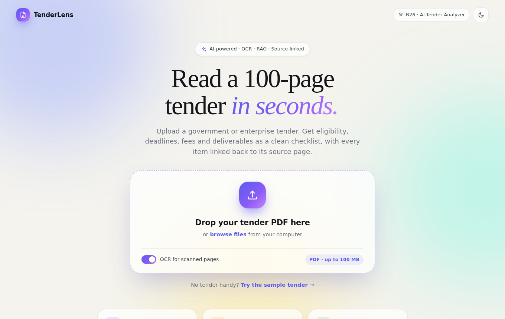
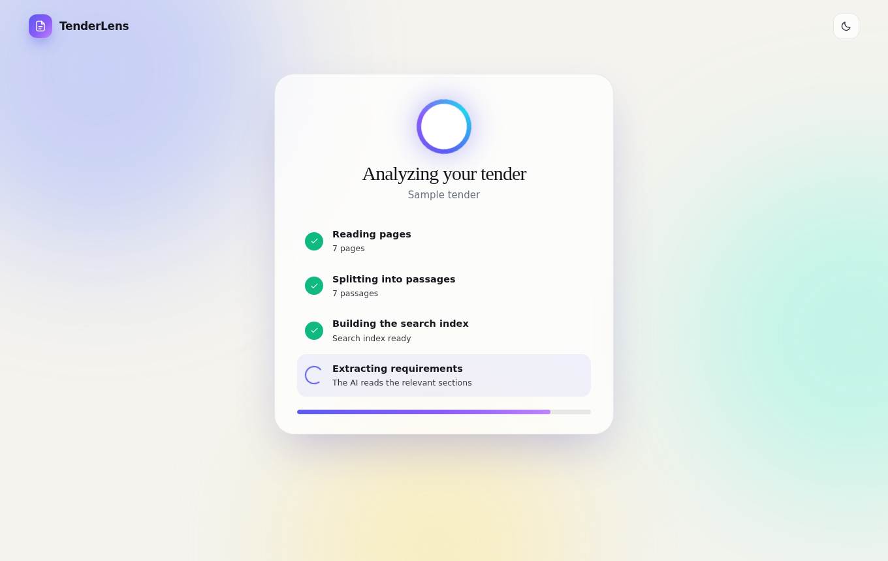
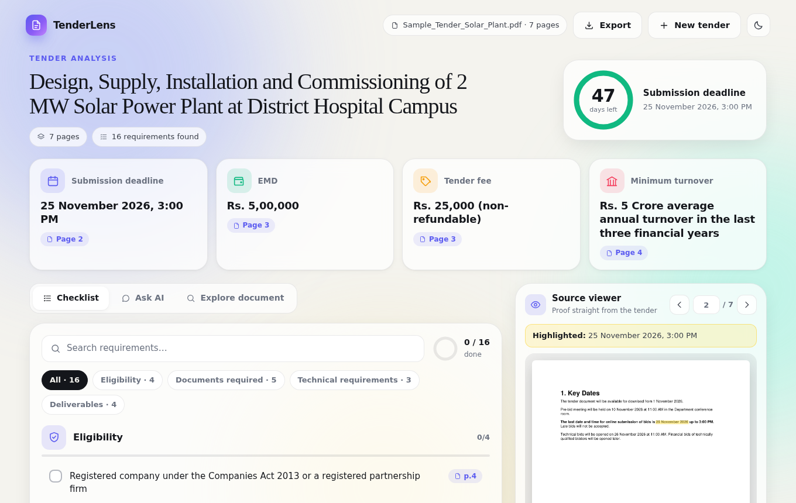
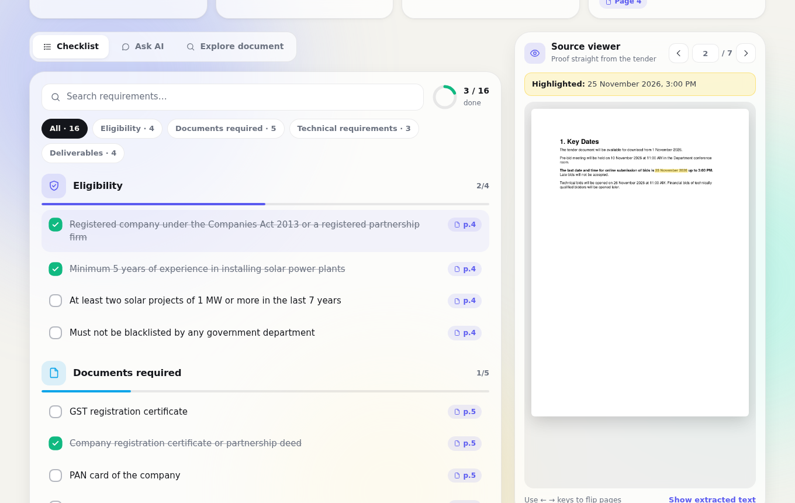
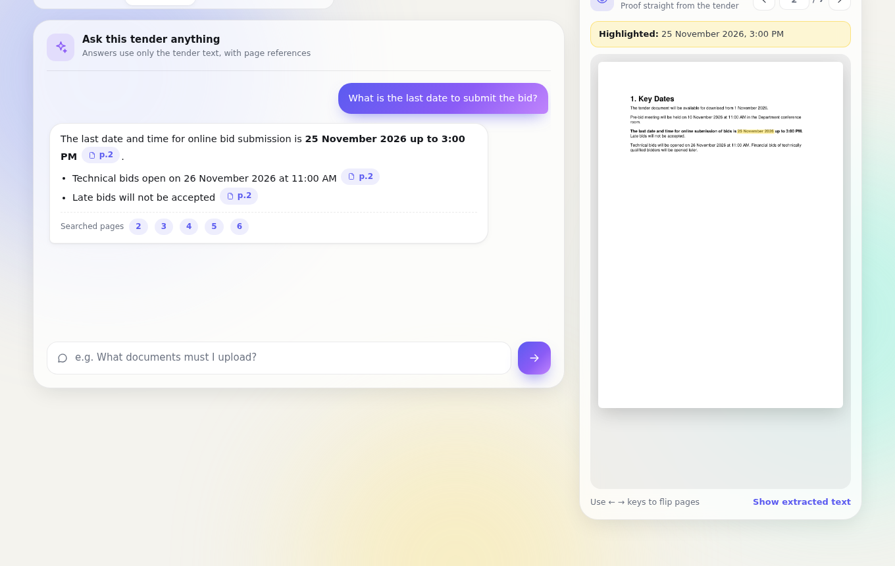
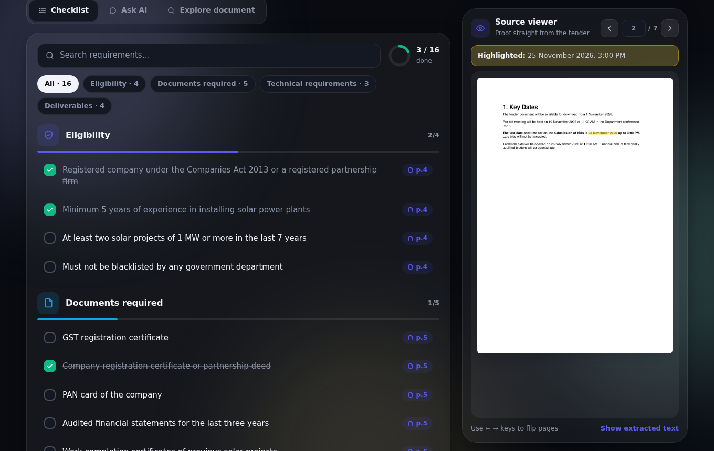
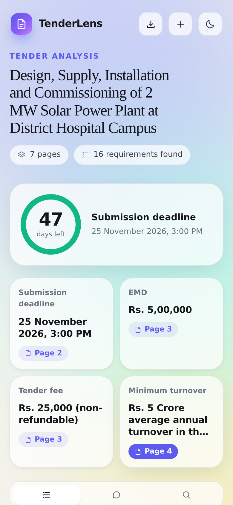
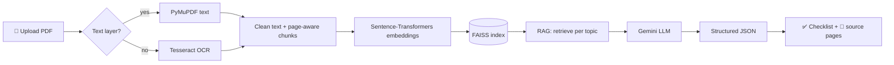

<div align="center">



<br><br>

# 📄 TenderLens

### AI Tender Document Analyzer

**Read a 100-page tender in seconds.**
Upload a government or enterprise tender PDF and get eligibility, deadlines, fees and deliverables
as a clean checklist, with every item linked back to the exact source page.

<br>


**[Quick start](#-quick-start)** · **[Features](#-features)** · **[How it works](#-how-it-works)** · **[Screenshots](#-screenshots)** · **[API](#-api-reference)** · **[Roadmap](#-roadmap)**

</div>

---

## ✨ Why TenderLens?

Preliminary tender analysis is slow. Someone has to scroll through dozens of pages to find the deadline,
the EMD amount, the turnover rule, the documents to attach and what must be delivered. Miss one line and the bid can be rejected.

**TenderLens turns that first read into a few seconds of work.** It extracts the key requirements with an LLM,
but never asks you to blindly trust it: every answer shows the source page, highlighted, so you can verify it in one click.

> Project **B26 · FAIR-AI-B01** — *reduce the time required for preliminary tender analysis.*

---

## 🚀 Features

| | Feature | What you get |
|---|---|---|
| 📤 | **Drag-and-drop upload** | Any text-based or scanned tender PDF, up to 100 MB |
| 🔍 | **OCR fallback** | Pages with no text layer are read automatically with Tesseract |
| 🧠 | **RAG pipeline** | Only the relevant passages go to the LLM, not the whole 100 pages |
| ✅ | **Interactive checklist** | Eligibility, documents, technical requirements and deliverables with progress rings and search |
| 📍 | **Source-linked answers** | Every item has a page chip. Click it to see the page with the matching text highlighted |
| ⏳ | **Deadline countdown** | A live ring that turns amber, then red, as the submission date gets close |
| 💬 | **Ask the tender** | Chat with the document. Answers cite page numbers and use only the tender text |
| 🔎 | **Document explorer** | Search any word across all pages, jump straight to the matches |
| 📥 | **Export** | Download the checklist as CSV (with your ticked items) or as JSON |
| 🌗 | **Light and dark mode** | Polished, responsive UI that also works on a phone |
| 🎉 | **Small delights** | Animated checkboxes, step-by-step progress, confetti when you finish the checklist |

### 🛡️ Built to avoid made-up answers

- The LLM is told to use **only** the retrieved excerpts and to answer **"Not Found"** when something is missing.
- Every extracted value carries a **page number** the user can check.
- Only the retrieved excerpts are sent to the LLM. The PDF itself stays on your machine.

---

## 🖼️ Screenshots

<table>
  <tr>
    <td width="50%"><b>1 · Analysis in progress</b><br></td>
    <td width="50%"><b>2 · Dashboard</b><br></td>
  </tr>
  <tr>
    <td width="50%"><b>3 · Checklist with source highlighting</b><br></td>
    <td width="50%"><b>4 · Ask the tender</b><br></td>
  </tr>
  <tr>
    <td width="50%"><b>5 · Dark mode</b><br></td>
    <td width="50%" align="center"><b>6 · Mobile</b><br></td>
  </tr>
</table>

---

## 🧩 How it works



1. **Parse.** PyMuPDF extracts the text of each page. If a page has almost no text, it is rendered to an image and read with **Tesseract OCR**.
2. **Clean and chunk.** Text is cleaned and split into overlapping chunks. **Each chunk keeps its page number**, which is what makes the source links possible.
3. **Embed and index.** Chunks become vectors with `all-MiniLM-L6-v2` and are stored in a **FAISS** index.
4. **Retrieve (RAG).** For each topic (deadline, fees, turnover, eligibility, documents, technical, deliverables) the most relevant chunks are fetched.
5. **Extract.** The excerpts, labelled `[Page N]`, go to **Gemini**, which returns strict JSON with a value and a page for each field.
6. **Present.** The UI turns that JSON into the dashboard, checklist, countdown and source viewer.

### Example output

```json
{
  "submission_deadline": { "value": "25 November 2026, 3:00 PM", "page": 2 },
  "emd":                 { "value": "Rs. 5,00,000",              "page": 3 },
  "minimum_turnover":    { "value": "Rs. 5 Crore average annual turnover", "page": 4 },
  "eligibility": [
    { "value": "Minimum 5 years of experience in installing solar power plants", "page": 4 }
  ],
  "deliverables": [
    { "value": "Comprehensive maintenance for 5 years", "page": 7 }
  ]
}
```

---

## 🛠️ Tech stack

| Layer | Technology |
|---|---|
| Language | Python 3.12 |
| Backend | Flask (streaming progress events as NDJSON) |
| PDF parsing and page rendering | PyMuPDF |
| OCR | Tesseract + pytesseract |
| Embeddings | Sentence-Transformers (`all-MiniLM-L6-v2`) |
| Vector search | FAISS (`faiss-cpu`) |
| LLM | Google Gemini via `google-genai` (free tier works) |
| Frontend | Vanilla HTML, CSS and JavaScript. No build step |

---

## ⚡ Quick start

### 1. Clone

```bash
git clone https://github.com/durgeshmahajann/AI-Tender-Document-Analyzer.git
cd AI-Tender-Document-Analyzer
```

### 2. Create a virtual environment and install

```bash
python3 -m venv venv
source venv/bin/activate          # Windows: venv\Scripts\activate
python -m pip install -r requirements.txt
```

> The first install takes a few minutes because `sentence-transformers` pulls in PyTorch.

### 3. Install Tesseract (only needed for scanned PDFs)

```bash
brew install tesseract            # macOS
sudo apt install tesseract-ocr    # Ubuntu / Debian
```

### 4. Add your free Gemini API key

1. Open [aistudio.google.com](https://aistudio.google.com) and sign in.
2. Open the **API keys** page and create a key.
3. Create a `.env` file in the project folder:

```env
GEMINI_API_KEY=your_key_here
GEMINI_MODEL=gemini-3.8-flash
GEMINI_FALLBACK_MODELS=gemini-3-flash-preview
```

> 🔒 `.env` is in `.gitignore`. Never commit your key.

### 5. Run

```bash
python server.py
```

Open **http://localhost:8000**. The browser opens automatically.
No tender at hand? Click **Try the sample tender**.

---

## 🧪 Try it with the sample tender

The repo ships with `data/Sample_Tender_Solar_Plant.pdf`, a fictional 7-page tender for a 2 MW solar plant.
A correct run should find:

| Field | Expected value | Page |
|---|---|---|
| Submission deadline | 25 November 2026, 3:00 PM | 2 |
| Tender fee | Rs. 25,000 | 3 |
| EMD | Rs. 5,00,000 | 3 |
| Minimum turnover | Rs. 5 Crore (last three financial years) | 4 |
| Experience | 5 years, plus two projects of 1 MW or more | 4 |
| Documents | GST, registration, PAN, audited financials and more | 5 |
| Technical | IEC-certified modules, inverters over 98% efficiency | 6 |
| Deliverables | Design, installation, commissioning, 5-year maintenance | 7 |

---

## ⚙️ Configuration

| Variable | Default | Purpose |
|---|---|---|
| `GEMINI_API_KEY` | none (required) | Your Gemini API key |
| `GEMINI_MODEL` | `gemini-3.8-flash` | Main model. Change it if Google retires the name |
| `GEMINI_FALLBACK_MODELS` | empty | Comma-separated backups tried if the main model is busy or unavailable |
| `PORT` | `8000` | Port for the local server |

The extractor automatically **retries with backoff** when Gemini reports it is busy (HTTP 503 or 429).

---

## 🗂️ Project structure

```
AI-Tender-Document-Analyzer/
├── server.py                 # Flask server and API
├── web/
│   ├── index.html            # App shell
│   ├── style.css             # Design system (light and dark)
│   └── app.js                # UI logic: upload, progress, checklist, chat, viewer
├── modules/
│   ├── pdf_processor.py      # Text extraction, page rendering, highlighting
│   ├── ocr_processor.py      # Tesseract OCR for scanned pages
│   ├── chunker.py            # Page-aware chunking
│   ├── embeddings.py         # Sentence-Transformers
│   ├── vector_store.py       # FAISS index and search
│   ├── rag.py                # Topic queries and context building
│   └── extractor.py          # Gemini extraction and Q&A
├── data/
│   └── Sample_Tender_Solar_Plant.pdf
├── docs/screenshots/         # Images used in this README
├── requirements.txt
├── .env.example
└── README.md
```

---

## 🔌 API reference

| Method | Endpoint | Description |
|---|---|---|
| `POST` | `/api/analyze` | Upload a PDF (`file`, `ocr`). Streams progress events and the final result as NDJSON |
| `POST` | `/api/analyze-sample` | Analyze the bundled sample tender |
| `GET` | `/api/page/<doc>/<n>?hl=text` | Page `n` as a PNG, with the matching text highlighted |
| `GET` | `/api/text/<doc>/<n>` | Extracted text of a page |
| `GET` | `/api/search/<doc>?q=term` | Find a word or phrase across all pages |
| `POST` | `/api/ask` | Ask a question: `{ "doc": "...", "question": "..." }` |
| `GET` | `/api/config` | Whether the sample tender is available |

---

## 🧯 Troubleshooting

| Problem | Fix |
|---|---|
| `GEMINI_API_KEY is missing` | Create `.env` next to `server.py` with your key |
| `API key not valid` | Copy a fresh key from AI Studio. Make sure there is no placeholder text |
| `404 ... model is no longer available` | Set `GEMINI_MODEL` to a current Flash model name from AI Studio |
| `503 ... high demand` | Temporary. The app retries automatically. Try again in a minute |
| `TesseractNotFoundError` | Install Tesseract, or turn off the OCR switch |
| `No module named ...` | Activate the venv, then run `python -m pip install -r requirements.txt` |
| First run feels stuck | The embedding model loads once (about a minute). Later runs are fast |

---

## 🗺️ Roadmap

Ideas for taking TenderLens further:

- [ ] Compare several tenders side by side
- [ ] Hindi and regional-language OCR (`pytesseract` language packs)
- [ ] Export a one-page bid/no-bid summary as PDF or Excel
- [ ] Add the deadline to your calendar (`.ics` download)
- [ ] Table-aware extraction for BOQ and price schedules
- [ ] Upload several tender documents (corrigenda, annexures) into one analysis
- [ ] Docker image for one-command setup

---

## 🙌 Contributing

Issues and pull requests are welcome. If you plan a bigger change, open an issue first so we can discuss it.

## 📜 Disclaimer

TenderLens is an assistant for **preliminary** analysis. AI can miss or misread details.
Always verify critical conditions, such as deadlines, fees and eligibility, against the original tender document before bidding.
The sample tender in this repository is fictional.

---

<div align="center">

Built for **B26 · FAIR-AI-B01 — AI Tender Document Analyzer** by [Durgesh Mahajan](https://github.com/durgeshmahajann)

If this project helped you, consider giving it a ⭐

</div>
